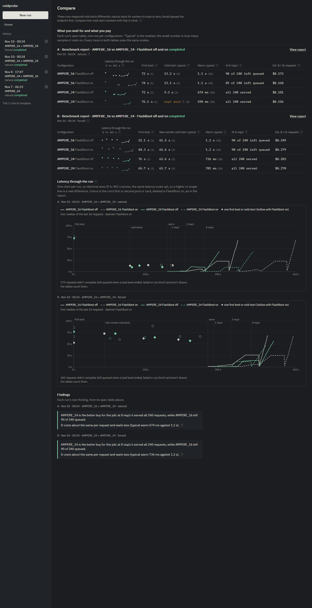
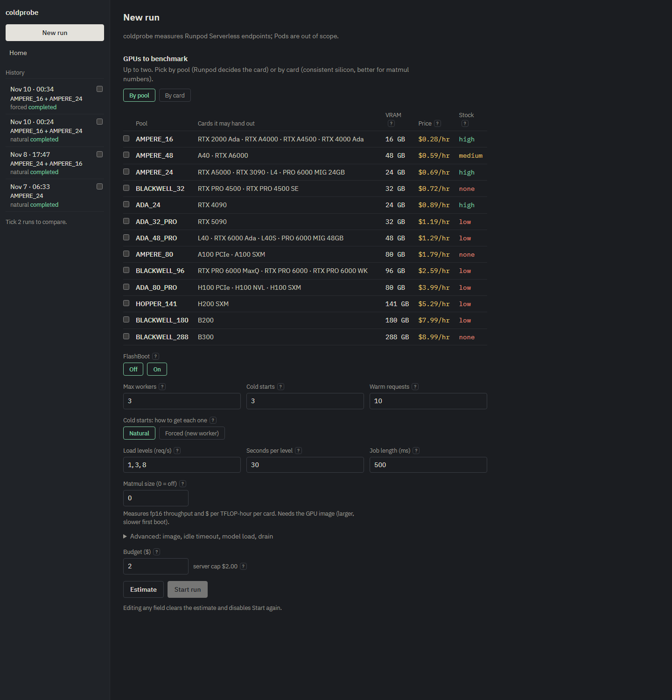

# coldprobe

coldprobe benchmarks Runpod Serverless endpoints. For each GPU pool or card you pick (up to two), it creates a temporary endpoint with FlashBoot off and another with it on, then measures the first boot, cold starts, warm latency and throughput under open-loop load, and estimates the cost per 1,000 requests. It deletes every endpoint it creates when the run ends, however it ends, and a janitor sweeps anything left; a budget guard stops a run before its worst-case spend can pass the budget you set. It is a single Go binary with an embedded React UI and a SQLite file for history.

## What it found

The latest recorded run (2026-11-10, natural cold-start mode) used two pools, AMPERE_16 and AMPERE_24, each with FlashBoot off and on: `maxWorkers` 2, a 5 s idle timeout, 3 cold samples, 10 warm requests, open-loop load at 1, 3 and 8 req/s, 500 ms jobs and a 5 s simulated model load. coldprobe records the GPU each job actually ran on: AMPERE_16 placed every job on an RTX A4500, and AMPERE_24 on an RTX PRO 6000 Blackwell MIG slice.

| 500 ms job | first boot | cold start, p50 (n) | warm request, p50 | estimated $ per 1k requests | left queued at 8 req/s |
|---|---|---|---|---|---|
| AMPERE_16, FlashBoot OFF | 72.0 s | 13.2 s (3) | 1.14 s | $0.173 | 90 |
| AMPERE_16, FlashBoot ON | 74.0 s | 13.1 s (3) | 1.15 s | $0.168 | 89 |
| AMPERE_24, FlashBoot OFF | 72.0 s | 9.3 s (3) | 674 ms | $0.181 | 0 |
| AMPERE_24, FlashBoot ON | 76.1 s | kept warm (0) | 598 ms | $0.156 | 0 |

- **FlashBoot gave AMPERE_16 the same median cold start** (13.2 s vs 13.1 s); one of the three FlashBoot cold starts took 1.1 s. On AMPERE_24 it kept its worker alive, so there was no cold start to measure. coldprobe reports that as "kept warm" rather than inventing a number. Three cold samples per config is a small sample, and FlashBoot's effect varies: in the first real run (2026-11-07, AMPERE_24, one worker, n=2) it cut the median cold start from 27.3 s to 0.76 s.
- **Two A4500 workers couldn't keep up with 8 req/s:** about 90 requests per config were still queued at the drain deadline, while the Blackwell MIG slice drained everything.
- **Cost:** $ per 1k is coldprobe's estimate, not a bill. The jobs of the whole run are attributed about $0.22; the budget guard's upper bound for the run (every endpoint billed for `maxWorkers + 1` workers the whole time) was at most $1.23.

A second run with the same settings in forced mode, which pauses the endpoint before each cold sample, put every cold start on a brand-new worker on both pools, FlashBoot on or off: typical (p50) values 61-66 s, individual samples 56-88 s. The UI therefore labels those "new-worker cold start" and never presents them as a FlashBoot comparison. Both runs' full tables, the method and what's still unverified: [docs/runpod-api.md](docs/runpod-api.md#recorded-runs-2026-11-10).

## Screenshots

The report for the natural-mode run above, laid out like a spec sheet: the pools in the run, one table row per configuration with its latency trace and sample sizes, a one-paragraph finding, latency through the run, where a cold start's time goes, FlashBoot on its own, and every number with its sample size.


The natural and forced runs in the compare view: both spec tables stacked, one latency chart per run on identical axes, and both findings. It warns that the two modes measure cold starts differently.



## Quick start

Two ways to run it; both open the app at http://127.0.0.1:8080. You need either Docker with Compose (Docker Desktop on Windows or macOS, Docker Engine on Linux) or Go 1.26+ and Node 24. Every setting is a variable in `.env`, copied from [.env.example](.env.example).

### Try it with no Runpod account (fake mode)

`COLDPROBE_FAKE=1` runs coldprobe against an in-process fake of Runpod's management and job APIs, with realistic timings (a 20 s image pull, 8 s cold starts, 1.5 s with FlashBoot) and a snapshot of the real GPU catalog. Nothing real is created or billed, and no API key is needed. A run with the form's defaults takes about 2-3 minutes.

```sh
cp .env.example .env
# edit .env: set COLDPROBE_FAKE=1 (leave RUNPOD_API_KEY empty)
docker compose up --build
```

Without Docker:

```sh
(cd web && npm ci && npm run build)   # the UI is embedded into the binary at build time
COLDPROBE_FAKE=1 go run ./cmd/coldprobe
```

### Run it against Runpod (real mode)

Real mode creates endpoints on your Runpod account and bills them. Each run is capped by its budget, and every endpoint coldprobe creates is deleted when the run ends. Set these in `.env`:

| Variable | What to set |
|---|---|
| `RUNPOD_API_KEY` | An API key with read and write access, from the Runpod console under Settings, API Keys. It is read from the environment at start, never written anywhere. |
| `COLDPROBE_FAKE` | `0`. |
| `COLDPROBE_BUDGET_CAP_USD` | The most any one run may spend. The form can't ask for more. Default `2.00`. |
| `COLDPROBE_MAX_WORKERS` | Optional ceiling on workers per endpoint, 1 to 60. The form defaults to 3, Runpod's own default. |
| `COLDPROBE_WORKER_IMAGE` | Leave as is: the public synthetic worker image. |

```sh
cp .env.example .env
# edit .env: paste your key after RUNPOD_API_KEY=
docker compose up --build
```

Without Docker, export the variables first (the binary reads the environment, not the file): `set -a; . ./.env; set +a; go run ./cmd/coldprobe`.

A first run with the form's defaults (two pools, FlashBoot off and on, 3 cold samples, three load levels) takes about 10 minutes and has cost well under $1 on the pools recorded above; the New run page shows the worst-case spend before you start, and refuses a pool with no stock.

The port is published on loopback only (`127.0.0.1:8080:8080`). The app has no login and `POST /api/runs` spends money, so it must not be reachable from the LAN. Inside the container it listens on `:8080`; compose sets that, so leave `COLDPROBE_ADDR` in `.env` as it is. The SQLite history lives on a Docker volume (or `coldprobe.db` in the working directory without Docker) and survives restarts.

## Development

```sh
(cd web && npm ci)             # once, before make dev / make test: installs the UI's pinned dependencies
make dev                       # Go in fake mode + Vite dev server with hot reload (proxies /api to Go)
make test                      # go vet, go test -race, and the UI build (strict tsc)
bash scripts/smoke.sh --quick  # the real binary in fake mode: API, guards, cancel; a few seconds
```

Other `make` targets:

| Target | What it does |
|---|---|
| `build` | Builds the UI and the Go binary. |
| `up` | `docker compose up --build`. |
| `janitor` | Lists leftover `bench-coldprobe-*` endpoints on your account, in a one-off container (needs Docker and `.env`). A dry run; `make janitor ARGS=-delete` deletes them. |
| `worker-test` | Runs the Python worker's tests. |
| `scan` | Runs gitleaks over the whole git history (the pre-commit hook only scans what's staged). |

UI tests are `npm test` in `web/` (vitest). The full smoke test (`bash scripts/smoke.sh`, about 3 minutes) also runs a fake run to completion, a forced-mode run, and a SIGTERM mid-run.

## How it works

- **One Go binary** serves the JSON API, a Server-Sent Events stream per run and the embedded UI, with plain `net/http` and no framework. History is in SQLite through a pure-Go driver, so it builds with `CGO_ENABLED=0`.
- **Pick GPUs by pool or by card.** A pool is Runpod's unit of GPU selection and may hand out several cards; picking a card instead creates the endpoint on that card's pool with every other card in it excluded (`excludedTypes`), so the run measures one kind of silicon at that card's price. Each config is one GPU choice with FlashBoot off or on.
- **A stock gate before Start.** Starting a run re-reads Runpod's GPU catalog and refuses, before creating anything, a pool or card with no stock; low stock needs one deliberate "Start anyway". The New run form shows each choice's price and stock before you get that far.
- **Each config runs a fixed protocol** on its own endpoint, in parallel with the others: first boot, cold samples, sequential warm requests, then load levels. If no worker has been placed 90 s into a config's first boot, the run says so (an amber warning in the UI that stays until the boot ends) rather than waiting out the 600 s timeout in silence.
- **Load is open-loop.** Requests go out on a fixed schedule whether or not earlier ones have returned, and latency is counted from when each request should have been sent, so a saturated endpoint can't hide its queue (coordinated omission).
- **Teardown is guaranteed.** The delete is deferred the moment an endpoint exists, runs on a context that ignores cancellation, and is retried. Cancel, a failed config, the budget guard and SIGTERM all end in the same teardown.
- **The budget guard uses an upper bound,** not polled usage: every live endpoint billed for `maxWorkers + 1` workers from just before its create until its delete. It's local arithmetic every second, and it aborts when that bound, projected through one more tick and a teardown, would pass the budget.
- **A janitor** deletes leftover `bench-coldprobe-*` endpoints at startup and before every run, and is also a CLI subcommand.
- **The live view is SSE.** The UI loads a snapshot of the run, then applies events (job results, statuses, the spend bound); a gap in the event sequence means it re-fetches the snapshot.
- **The report** is React + Recharts in a spec-sheet style, drawn from the stored jobs and summaries, with every number labelled in plain words and its sample size beside it.
- **The worker** is a synthetic Python handler that sleeps for `sleep_ms`, published as a public image on GHCR. It measures platform overhead (scheduling, boot, queueing), not model speed.



Picking GPUs by pool or by card, with current price and stock.

How it talks to Runpod, and every quirk found on the real API: [docs/runpod-api.md](docs/runpod-api.md).

## Safety

- The server binds `127.0.0.1:8080` by default, and the container is published on loopback only.
- `http.CrossOriginProtection` and a JSON-only `Content-Type` check stop other web pages from starting runs (CSRF). A `Host` allowlist stops DNS rebinding.
- One run at a time: a second `POST /api/runs` gets 409, so at most one budget is being spent at once.
- Every endpoint coldprobe creates is named `bench-coldprobe-<run>-<n>`. The janitor only ever touches that prefix, and spares a young endpoint from a run it doesn't know, which may be another instance's.
- The API key is read from the environment, never baked into an image, and redacted from every log line and error.

## Reach goal: real GPU work

The synthetic worker only sleeps, so it can't compare GPUs on real work or see CUDA initialisation inside a cold start. coldprobe has an opt-in GPU benchmark: a separate CUDA worker image that times fp16 matrix multiplies, and summarises TFLOPS, $ per TFLOP-hour and cold CUDA init per GPU model. It is off unless a run asks for it. To run one, set the image to `ghcr.io/josh10111/coldprobe-worker-gpu:latest` and set a matmul size (`matmulN` in the request body, "Matmul size" in the New run form), for example 4096. Picking by card keeps each config on one kind of GPU, so its matmul numbers aren't a mix.


The GPU matmul run's report: measured fp16 TFLOPS and $ per TFLOP-hour per card.

## Docs

[docs/runpod-api.md](docs/runpod-api.md) holds the notes on the Runpod API and every quirk found on it.

## License

MIT. See [LICENSE](LICENSE).
